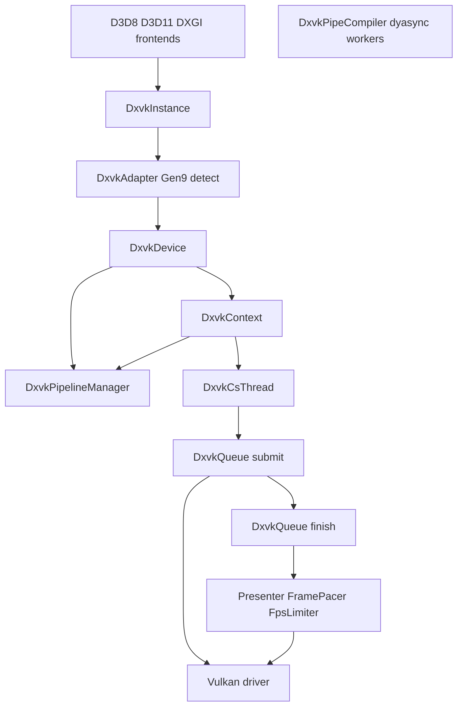
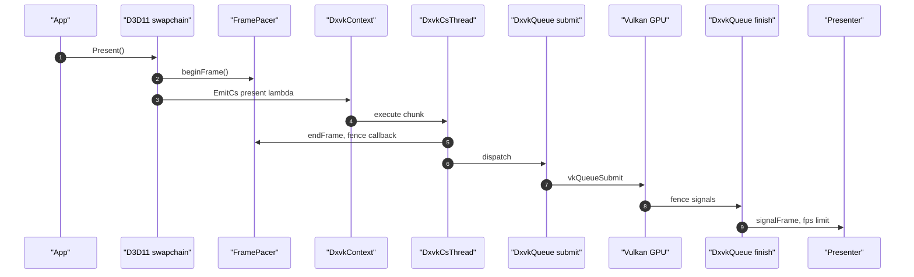

# dxvk-630

DXVK fork for Intel UHD 630 (Gen9.5) iGPUs on low-power UMA systems with constrained memory bandwidth. Built on DXVK v3.0.2, with async pipeline compilation from Sarek dyasync (v1.12.0) and a Gen9 low-power profile.

## Architecture

Flow: D3D8/D3D9/D3D11/DXGI frontends feed DxvkInstance, which detects Gen9 hardware and creates DxvkDevice. The device owns DxvkPipelineManager (with dyasync worker threads), DxvkContext, DxvkCsThread, and DxvkQueue, which submits command buffers to the Vulkan driver. Presents flow back through Presenter, FramePacer, and FpsLimiter. Editable source: `docs/architecture.mmd`.

Flow: App calls Present() on the D3D11 swapchain, which begins the frame pacer, emits a CS present lambda to DxvkContext, executes the chunk on DxvkCsThread, ends the frame with a fence callback, dispatches to DxvkQueue for vkQueueSubmit. The GPU fence signals DxvkQueue finish, which calls Presenter signalFrame and fps limit. Editable source: `docs/architecture-frame.mmd`.

## Changes from upstream DXVK

| Change | Description |
|--------|-------------|
| Gen9 low-power profile | Detects UHD 630 hardware, sets memory budget to half the largest DEVICE_LOCAL heap, enables async compilation, clamps dyasync threads to 1..4. `dxvk.conf` overrides defaults |
| Dyasync pipeline compilation | Background threads compile pipelines off the hot path. `dxvk.enableDyasync`, `dxvk.numDyasyncThreads` |
| Frame pacer | Three modes: max-frame-latency, low-latency, min-latency. `dxvk.framePace` or `DXVK_FRAME_PACE`, `dxvk.lowLatencyOffset` |
| Narrowed pipeline barriers | Transfer/SDMA paths use transfer-only stage masks; external consumers stay `ALL_COMMANDS_BIT`. `d3d11.relaxedBarriers` |
| Pipeline cache persistence | Cache saved at exit, reused across runs |
| ALLOW_TEARING / forceHdr | Immediate present for DXGI flip model; forced HDR10 |
| Link-time optimization | Release builds use LTO |
| D3D9 frame pacer wiring | FramePacer in D3D9 swapchain alongside D3D11 |

## Changes from Sarek

Sarek contributed dyasync and Gen9 detection. Targets UHD 630 only: no multi-vendor GPU profiles, simplified profile resolution, reworked frame pacer with three latency modes.

## Building

Needs llvm-mingw (ucrt), glslangValidator, meson 1.11+, ninja on PATH:

    git clone https://github.com/EzeriumChristinal/dxvk-630.git
    cd dxvk-630
    meson setup --cross-file build-win64.txt --buildtype release build-release
    ninja -C build-release

Output: 5 DLLs under `build-release/src/{d3d8,d3d9,d3d10,d3d11,dxgi}/`.
Cross-compiles to `x86_64-w64-mingw32` from Linux or Windows.

## Configuration

Shipped `dxvk.conf` sets the defaults. Put it next to `dxvk.dll`, point `DXVK_CONFIG_FILE` at it, or drop a per-game `dxvk.conf` in the game dir. Fork keys:
`dxvk.enableDyasync` (auto/on/off), `dxvk.numDyasyncThreads` (0 = auto),
`dxvk.framePace` (empty / low-latency / min-latency), `dxvk.lowLatencyOffset`
(microseconds, -10000..10000), `dxvk.maxMemoryBudget` (bytes; Gen9 auto = heap / 2).

## Credits

- [DXVK](https://github.com/doitsujin/dxvk) - upstream by Philip Rebohle
- [DXVK-Sarek](https://github.com/pythonlover02/DXVK-Sarek) - dyasync and frame-pacer
